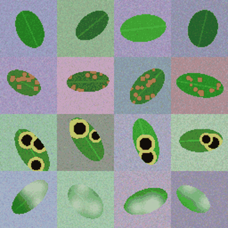

# 18 · CNN para detectar enfermedades en hojas (PyTorch, CPU)

Clasificador de imágenes de hojas: **sana / roya / mancha negra / mildiu**. Es una CNN compacta en PyTorch que entrena en segundos en CPU con hojas **sintéticas**. Además viene preparada para entrenarse con el dataset real **PlantVillage**.

## Qué demuestra
- **Generador procedural de imágenes**. Dibuja hojas con rotación, tamaño, color, fondo y ruido aleatorios y les agrega síntomas por clase:
  - pústulas naranja para la roya;
  - manchas negras con halo amarillo;
  - parches difusos blancos para el mildiu.
  Los tests no necesitan descargar nada.
- **CNN propia** (≈24 k parámetros):
  - 3 bloques Conv-BN-ReLU-MaxPool;
  - *Global Average Pooling*, que acepta cualquier resolución;
  - Dropout y una capa lineal.
- **Entrenamiento correcto**:
  - AdamW + OneCycleLR;
  - *label smoothing*;
  - *early stopping* que restaura los mejores pesos;
  - semillas fijas para la reproducibilidad.
- Evaluación con exactitud y **matriz de confusión**.
- `DatasetCarpetas`: lector estilo *ImageFolder* que no depende de torchvision, con aumentos de espejo.
- Persistencia segura: se guarda sólo el `state_dict` y se carga con `torch.load(weights_only=True)`, sin pickle arbitrario.



## Usar PlantVillage (dataset real)
- Repositorio: https://github.com/spMohanty/PlantVillage-Dataset. Contiene ≈54.000 imágenes de 38 clases `Especie___Enfermedad`, con licencia CC BY-SA 3.0. Hughes & Salathé, 2015, *arXiv:1511.08060*.
- No se incluye en el proyecto por su tamaño (≈1 GB). Descargalo a mano y usá la carpeta `raw/color/`:
```bash
cnn-plantas entrenar --carpeta PlantVillage-Dataset/raw/color --lado 64 --epocas 20 --salida pv.pt
cnn-plantas predecir --modelo pv.pt foto_hoja.jpg
```
- Para el dataset real se usa `ancho=32`, unos 95 k parámetros. Con 64×64 y CPU, cada época tarda varios minutos.
- Ojo: PlantVillage tiene fondos de laboratorio muy uniformes. Un modelo con >95 % allí generaliza mal a fotos de campo. Conviene validar con imágenes propias y usar aumentos más agresivos o *transfer learning* (p. ej. MobileNetV3).

## Arquitectura
```
src/plantas/
├── datos.py          # generar_hojas(), DatasetCarpetas, imagen_a_tensor()
├── modelo.py         # RedHojas (nn.Module)
├── entrenamiento.py  # Clasificador: entrenar/evaluar/predecir/guardar/cargar; dividir()
└── cli.py            # demo | entrenar | predecir
```

## Instalación y uso
```bash
pip install torch --index-url https://download.pytorch.org/whl/cpu
pip install -e ".[dev]"
cnn-plantas demo           # 480 hojas sintéticas, ~3 s en CPU
```
Con la demo se obtuvo una exactitud de validación de **1.000** (azar = 0.25) y una matriz de confusión diagonal.

## Tests
```bash
pytest     # ~3 s
```
Cubren el generador (forma y determinismo), la red con distintas resoluciones y 38 clases, que el modelo aprenda (≥ 85 % y pérdida decreciente), la lectura de carpetas, la predicción desde un archivo, la persistencia y la CLI.

## Limitaciones
- Las hojas sintéticas son mucho más fáciles que las fotos reales: el 100 % de la demo **no** dice nada sobre el rendimiento en campo.
- No se usa GPU (es intencional para que sea portable). Para entrenar en serio con PlantVillage conviene usar GPU y *transfer learning*.
