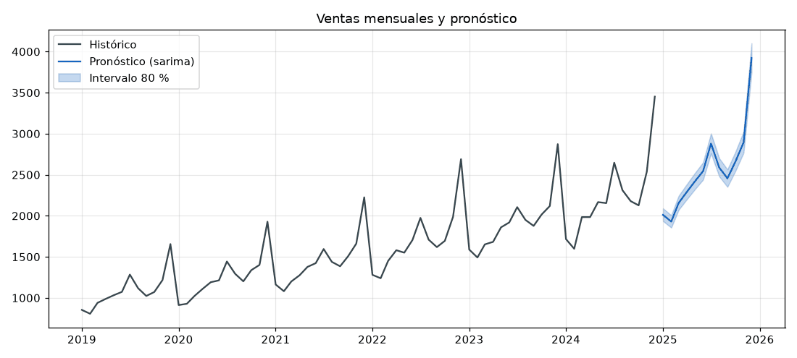

# 19 · Pronóstico de series de ventas (SARIMA + fallback)

Pronostica las ventas mensuales de los próximos meses con **intervalo del 80 %**. Usa una cadena de modelos con *fallback* explícito: **SARIMA → Holt-Winters → Naive estacional**.



## Qué demuestra
- **SARIMA** (`statsmodels.SARIMAX`) sobre `log(ventas)`, porque la serie es multiplicativa. Elige el orden `(p,1,q)(P,1,Q,12)` por **AIC** en una grilla chica de 16 combinaciones.
- **Fallback documentado y trazable.** Si un modelo no es viable, se pasa al siguiente y el motivo queda en `Pronostico.notas`. Un modelo no es viable cuando:
  - la serie es corta (SARIMA necesita ≥ 3 ciclos y Holt-Winters ≥ 2);
  - hay valores ≤ 0, que impiden aplicar el log;
  - el ajuste no converge o lanza una excepción;
  - falta statsmodels.

  El naive estacional siempre funciona, incluso con menos de un ciclo (cae a naive simple).
- **Backtesting con origen móvil**:
  - métricas MAE, MAPE y **MASE**; MASE < 1 significa mejor que el naive estacional;
  - además se mide la **cobertura real** del intervalo.
- Carga desde un CSV de transacciones, que se agregan por mes (los meses vacíos quedan en 0).
- Gráfico PNG con matplotlib en modo `Agg`, que no necesita pantalla.

## Resultados (backtest de la demo: 3 orígenes × 6 meses)

| Modelo | MAE | MAPE % | MASE | Cobertura 80 % |
|---|---|---|---|---|
| **SARIMA** | **66.6** | **3.0** | **0.32** | 0.67 |
| Holt-Winters | 85.2 | 3.8 | 0.40 | 0.61 |
| Naive estacional | 277.4 | 12.3 | 1.31 | 0.50 |

## Arquitectura
```
src/ventas/
├── datos.py       # generar_ventas(), cargar_csv()
├── modelos.py     # ModeloSARIMA, ModeloHoltWinters, NaiveEstacional, pronosticar() con fallback
├── evaluacion.py  # metricas(), backtest()
├── graficos.py    # graficar()
└── cli.py
```
Cada modelo cumple el `Protocol` `Modelo`. Se puede pasar una `cadena=[...]` propia, que es lo que usan los tests para simular fallos.

## Instalación y uso
```bash
pip install -e ".[dev]"
series-ventas pronosticar --demo --horizonte 12 --grafico pronostico.png
series-ventas pronosticar --csv ventas.csv --modelo holt_winters   # columnas: fecha, ventas
series-ventas backtest --demo
```

## Tests
```bash
pytest   # ~7 s (la grilla SARIMA es lo más lento)
```
Verifican:
- el generador y la carga de CSV;
- que el naive estacional sea exacto;
- que SARIMA supere al naive (MAPE < 5 %);
- los **tres caminos de fallback**: serie corta, excepción inyectada y valores en cero;
- el backtest, el PNG y la CLI.

## Limitaciones
- La serie es sintética, mensual, con un único producto y sin variables exógenas. Promociones, inflación y feriados entrarían como `exog` en SARIMAX.
- Los intervalos de Holt-Winters y del naive son aproximaciones (√h) y quedan algo estrechos (cobertura < 80 %).
- La grilla de órdenes es chica a propósito. Para más series conviene `pmdarima.auto_arima` o `statsforecast`.
